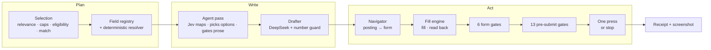

# job-autopilot

An agent that applies to jobs the way a careful person would. It picks the postings worth applying to, finds the application form, fills it from what you have on file, writes only the answers you would write yourself, and checks the result with 13 gates. Then it stops before submit unless you tell it to press.

This is **Autopilot**, the application agent in [Arkoo](https://arkoojobs.com), pulled out of Arkoo's server so it runs on its own: a CLI, a profile file, a CV and a job link. In Arkoo it is in private pilot. Automatic submission is switched off and limited to the owner, and no real application has been submitted through it yet. Everything below says what was built and what was measured, and nothing more.

```
$ npm run demo

Example Labs — Platform Engineer
  navigated   form after 2 hops
    1. http://127.0.0.1:62688/jobs/42 → goto http://127.0.0.1:62688/jobs/42/apply
    2. http://127.0.0.1:62688/jobs/42/apply → stop: application form
  mode        rehearse
  filled      10 of 11 fields, 0 refused, 1 left for you
    ✓ First name                           profile  Ada
    ✓ Email                                profile  ada@example.com
    ✓ Are you legally authorized to work i profile  Yes
    ✓ Will you now or in the future requir profile  No
    ✓ Describe a technical project you are profile  197 characters
    ✓ Resume/CV                            document Ada-Lovelace-CV.pdf
    – Gender (voluntary)                   eeo
    …
  form gates  6 of 6 passed
    …
  pre-submit  13 of 13 passed (Rehearsal: every gate, then stop before submit.)
    ✓ no_trap              no trap wording, no unplanned box ticked
    ✓ answer_sources       stored data and the applicant’s answers only
    ✓ documents_attached   CV attached
    ✓ submit_control       "Submit application"
    …
  outcome     rehearsed → awaiting_approval
              Rehearsal: every gate passed. Stopped before submit.
  receipt     preview: 10 fields, CV Ada-Lovelace-CV.pdf (sha256 5d2740e0a42f)
```

The demo runs a careers site on localhost and points the whole agent at it, in Chrome on your machine (add `-- --headed` to watch). Nothing leaves your machine. The gender question is voluntary and demographic, so the agent leaves it for you.

## How it works



### Plan

**Which jobs** (`src/selection/`). A keyword scorer ranks postings against each resume profile's target titles, skills, seniority, location and salary floor. Anything you already applied to is dropped, and so is any company over its limit: two applications per 30 days by default, or the employer's own stated cap if that's stricter. OpenAI's, for example, is 5 per 180 days. Then eligibility. Rules read the location field and the description for "must be based in", "authorised to work in", "no visa sponsorship", citizenship, clearance and time-zone overlap, and check them against where you live and where you're allowed to work. What the rules can't settle goes to Jev ([TypeSafe](https://docs.typesafe.ai)'s decision model) as one yes/no question. An "unknown" verdict is never sent hands-free. Finally Jev scores the fit of each shortlisted posting on four decomposed questions: title, must-have skills, seniority and kind of role. That costs about a tenth of a cent per posting, with a hard spend cap per run.

**What goes in each field** (`src/fields/`, `src/plan/`). Every question is matched to one of 120 canonical fields. It's matched by the ATS's own field key first, then by wording. On the 25 real forms in `test/fixtures/forms` (455 questions), the old pattern matcher mapped 167; the registry maps 454. The registry was written against those forms, so treat that as an upper bound. A deterministic resolver then answers each question from your data, in a fixed order: the job, this application's answers, the resume profile's overrides, your profile, values computed from it (years of experience from CV dates, a country from a city), the CV itself, and your answer bank.

### Write

**The agent pass** (`src/fields/agent.ts`) gets only what the resolver could not answer, and does three things:

1. **Map.** It asks Jev which canonical field an unrecognised question is. It acts only at 0.9 confidence or above, and caches the answer per ATS field so the next applicant's identical question costs nothing.
2. **Match an option.** You hold "No" and the form says "No, I will not require sponsorship". Jev picks the option that means the same, at 0.9 or above.
3. **Draft.** A Jev yes/no decides whether a free-text question wants a written answer at all. If it does, DeepSeek drafts one from your CV, profile and answer bank, and nothing else.

**The rule: no invented facts.** Personal, factual and legal questions are answered only from a value you stored, or one computed from stored values. That covers work authorisation, sponsorship, salary, years of experience, notice period, start date, "how did you hear", demographics and consents. The model may say *which* field a question is and *which* option a stored value is. It never decides the value. With nothing stored, the question is put to you. The rule is enforced in four places:

- **The agent never drafts a factual field.** Only open-ended, `draftable` fields and unrecognised text boxes are drafted.
- **A numeric guard** (`src/ai/facts.ts`) rejects any draft that states a number your material doesn't contain. "Led a team of 12" with no 12 in your CV is thrown away. Prompts can't be trusted with numbers; every model benchmarked still invents a few.
- **A source gate** at submit time refuses any value whose source isn't allowed. An agent-made value in a factual field fails it. So does an agent-picked choice, and so does an unreviewed draft under the default review-first policy.
- **Review.** Every draft is kept for you to approve or correct (`job-autopilot answers`). Your correction is what's used next time. An answer that names the employer stays with that employer.

### Act

**The navigator** (`src/navigator/`) gets from a posting's page to its application form for postings not on Greenhouse, Lever or Ashby. It is deterministic. It reads a snapshot of each page and stops on a known form, an application form (three or more fields, two about the applicant) or an account wall. Otherwise it follows the one control that most plainly says Apply, five hops at most. It never types, never presses anything inside a form, and never signs in or creates an account. Workday, Oracle, Taleo and iCIMS account walls and aggregator logins are handed back to you. A model-driven browser agent was considered and rejected: the measured hops were all plainly labelled, and what stopped postings was always a wall no agent should cross.

**The fill engine** is [`ats-form-fill`](https://github.com/jordan-ae/ats-form-fill), published separately. It extracts every question from the DOM, fills each one with real DOM events, and reads every value back from the page. The same bundle runs in your Chrome or a cloud browser (`local`, Browser Use or Browserbase).

**The form gates** (`src/executor/gates.ts`) run on what the page shows after filling:

| Gate | Fails when |
|---|---|
| `no_challenge` | a bot check, emailed code or login wall is on screen |
| `on_form_host` | the page moved off the form's host |
| `page_open` | the page is closed, unknown, or already a confirmation |
| `no_validation_error` | a field is flagged invalid |
| `readback` | a value didn't take, or changed after it took |
| `required_filled` | a required field reads back empty |

**The pre-submit gates** (`src/executor/submitGates.ts`) are pure functions. They're evaluated on the live page right before the one press:

| Gate | Fails when |
|---|---|
| `no_challenge` | a blocking check is on screen |
| `no_trap` | the form has bot-trap wording ("do NOT tick this box… automatic rejection"), or a box is ticked that the plan never ticked |
| `on_form_host` | the page is off the form's host |
| `job_open` | the posting is marked closed or the page says so |
| `no_validation_error` | a field is flagged invalid |
| `required_planned` | a required field is empty, or a value doesn't read back as planned |
| `answer_sources` | a value came from a source that isn't allowed (see the rule above) |
| `documents_attached` | the CV on the form isn't this application's CV, or the letter is missing |
| `submit_control` | there's no submit button, more than one, or it's disabled |
| `daily_cap` | today's sends reached your daily target (it waits for the next day) |
| `company_cap` | this company's limit is reached, ours or the employer's stated one |
| `compute_budget` | this month's spend would pass the budget |
| `eligibility` | selection said ineligible or below your minimum match; "unknown" waits for you |

**One press, never two.** Right before the press, the store does a compare-and-set that writes `submit_clicked_at`. Only the run that wins may press, and it presses once, with a real click on the one element the finder marked. Then it watches the page for a confirmation, a validation error or a bot check. A run that dies after the press becomes `unconfirmed`, never retried. A confirmation that arrives late still settles it. A submitted, unconfirmed, rehearsed or waiting-for-review application gets a receipt: each field as the form held it (with secrets and government IDs masked), the CV's name, size and hash (never the bytes), the page's confirmation, timings, cost, and one full-page screenshot.

### Submit is off

| Mode | What a run does |
|---|---|
| `dry_run` (default) | plan, write, fill, read back, the 6 form gates, stop |
| `--rehearse` | the above, plus all 13 pre-submit gates, the screenshot and a preview receipt, then stop |
| `--submit` | the above, then shows you everything it will send and presses only after you type the company's name |

Submitting on a form the navigator found needs `--agent-submit` as well. With no terminal to type into, nothing is pressed.

## Use it

```bash
git clone https://github.com/jordan-ae/job-autopilot && cd job-autopilot
npm install
npm run demo                      # the whole agent against a local careers page
```

It needs Node 20.6+ and Google Chrome (or set `LOCAL_CHROMIUM_PATH`).

Copy `examples/profile.example.json` and fill in your own details. Only `full_name` and `email` are required. Anything missing counts as "not on file", and a question that needs it is asked, never guessed. Then:

```bash
npx tsx src/cli/main.ts apply https://job-boards.greenhouse.io/<board>/jobs/<id> \
  --profile me.json --cv cv.pdf --rehearse --headed

npx tsx src/cli/main.ts answers                 # review what the agent drafted
npx tsx src/cli/main.ts show <attempt-id>       # the last report and receipt
npx tsx src/cli/main.ts select --jobs jobs.json --profile me.json --cv cv.pdf
```

Attempts, drafts, receipts and screenshots are kept in `.autopilot/`.

| Variable | For |
|---|---|
| `TYPESAFE_API_KEY` | Jev: the agent pass and selection. Without it, fields are filled from stored data only and selection picks nothing rather than guess. |
| `LLM_API_KEY`, `LLM_BASE_URL`, `LLM_MODEL` | Drafting: any OpenAI-compatible endpoint (Fireworks and DeepSeek V4 Pro by default). |
| `BROWSER_PROVIDER` | `local` (default), `browseruse` (`BROWSER_USE_API_KEY`) or `browserbase` (`BROWSERBASE_API_KEY`). |
| `AUTOPILOT_DAILY_CAP`, `AUTOPILOT_COMPANY_CAP`, `AUTOPILOT_COMPANY_WINDOW_DAYS`, `AUTOPILOT_MONTHLY_BUDGET_USD` | The limits the gates enforce (50, 2, 30 days, $4). |

Greenhouse uploads a file the moment it's attached, before submit. That means even a dry run sends your CV to Greenhouse's storage. No application is filed, but know that before you point it at a live form.

### As a library

```ts
import { FileStore, executorDeps, loadApplicant, newAttempt, postingFromUrl, runClaimedAttempt } from 'job-autopilot'

const store = new FileStore('.autopilot')
const applicant = loadApplicant({ profile: 'me.json', cv: 'cv.pdf' })
const posting = postingFromUrl('https://jobs.ashbyhq.com/acme/…', { company: 'Acme', role: 'Engineer' })
await store.savePosting(posting)
await store.createAttempt(newAttempt({ id: 'a1', userId: applicant.userId, jobId: posting.id, targetUrl: posting.apply_url, tailoredDocumentId: applicant.documentId }))

const deps = executorDeps({ store, applicant, mode: 'rehearse' })
const report = await runClaimedAttempt((await store.claimAttempt('a1', deps.owner, deps.leaseSeconds))!, deps)
```

Storage and billing are interfaces. In Arkoo, Postgres enforced the claim, the lease-guarded writes, the double-press guard and recovery. Here `Store` (`src/store/types.ts`) states the same four rules, and `MemoryStore` and `FileStore` keep them. A database-backed store only has to keep those promises. `BillingHooks` holds, charges and releases whatever a caller bills per application. The default bills nothing.

## Tested

```bash
npm test            # 531 tests, offline (happy-dom), no network, no browser
npm run typecheck
```

- **All 25 captured forms** (Greenhouse, Ashby, Lever). The gates decide from what the page shows, submit is never fired, every form's submit button is found, and Blissway's bot-trap box puts that posting off-limits.
- **The press, offline.** A captured Greenhouse form is filled by the real engine, and the "employer" answers the click by replacing the page. Covered: confirmation, a validation error after the press, a bot check after the press, no answer in time, the compare-and-set refusing a second press, a run dying after the press, a late confirmation, and the daily and company caps.
- **The store's rules.** Claim, lease, double-press guard, recovery and approval, in both stores.
- **The agent end to end**, with fakes for Jev and the drafter. It never drafts a factual answer, the number guard throws away an invented figure, an unreviewed draft holds the application, and a corrected draft is reused instead of redrafted.
- **Selection.** Eligibility rules across regions, time zones, sponsorship and citizenship; caps; dedupe; and the planner on a fixture board.

Checked by hand in a real browser (local Chrome): the demo end to end, including a confirmed submit on localhost, and a dry run on a live Greenhouse form with placeholder details and no files attached.

**Not yet done.** A real submission on a live ATS. That's the next step of Arkoo's pilot, and it's the only way to learn how bot checks score an automated submit. Multi-page forms aren't supported either: each Next sends data to the employer, so even a dry run would. Accounts are never created.

## License

MIT. See [LICENSE](LICENSE).
